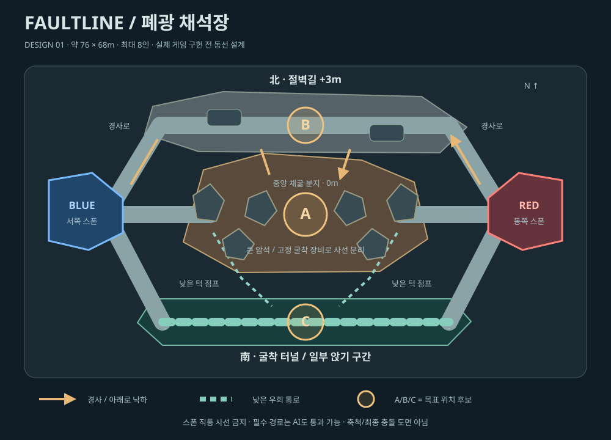
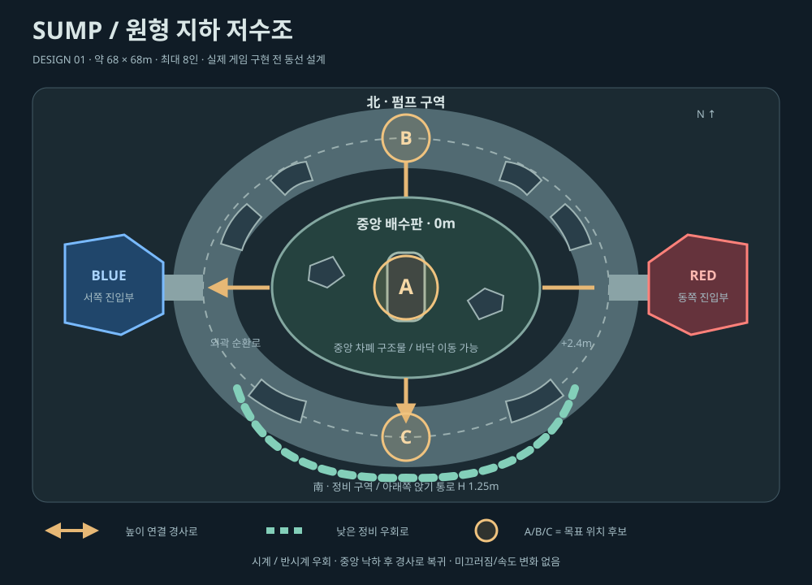

# 신규 팀 전장 4개와 목표형 교전 규칙

선택한 **FAULTLINE(폐광 채석장)**·**SUMP(원형 지하 저수조)**와 규칙 전용 **RELAY(순환 중계소)**·**BASTION(협동 방어 기지)**를 실제 플레이 가능한 전장으로 등록했다.

| 전장 | 허용 규칙 | 현재 평면도 |
| --- | --- | --- |
| FAULTLINE | 팀 데스매치만 | [현재 배치](../public/assets/maps/faultline.svg) |
| SUMP | 팀 데스매치만 | [현재 배치](../public/assets/maps/sump.svg) |
| RELAY | 이동 거점전만 | [현재 배치](../public/assets/maps/relay.svg) |
| BASTION | 협동 방어전만 | [현재 배치](../public/assets/maps/bastion.svg) |

아래 최초 설계 SVG는 축척 도면이 아닌 연결 구조 설명이다. 두 팀 데스매치 맵의 A/B/C 표기는 구역 설명용이며 점령 점수를 주지 않는다. 실제 활성 거점은 RELAY에만 있다. 개인전·일반·랭크는 기존 8개 전장만 사용한다.

## 공통 설계 원칙

- 경쟁 팀 규칙은 최대 8인 규모다. 협동전은 수비팀 4명(지원 AI 포함)과 공세 AI 동시 최대 4명으로 구성한다. 신규 맵은 개인전에 노출하지 않는다.
- 기존 건물·창문·계단 대신 지형 경사, 원형 순환로, 낙하 연결, 낮은 통로와 작은 점프 지름길을 사용한다.
- 기본 달리기와 Shift 무음 걷기, 무기별 이동 배율은 유지한다. 미끄러짐·강제 이동·속도 증가 구간은 만들지 않는다.
- 어느 스폰에서도 상대 스폰을 직접 볼 수 없게 한다. 각 스폰은 최소 두 개의 출구를 가진다.
- 주요 우회로는 사람과 AI가 모두 이용할 수 있게 한다. 필수 경로를 점프 전용으로 만들지 않는다.
- 주 이동 통로 폭은 약 2.5–3m 이상, 앉기 통로는 폭 1.6m 이상·천장 높이 1.25m를 기준으로 한다.
- 점프 지름길은 약 0.8–1.1m 높이로 시작한다. 긴 사선에는 측면 우회와 중간 엄폐를 함께 둔다.
- 첫 버전은 고정 지형으로 검증한다. 움직이는 리프트·수문·파괴 가능한 지형은 추후 별도 기능으로 다룬다.

## FAULTLINE / 폐광 채석장

**규모 초안:** 약 76 × 68m. 중앙 채굴 바닥을 높이 0m, 북쪽 절벽길을 +3m로 잡는다.

| 구역 | 구조와 플레이 |
| --- | --- |
| 중앙 채굴 분지 / A | 큰 암석과 고정 굴착 장비로 사선을 분리한다. 주요 교전 거리 약 15–30m. 중앙을 일직선으로 관통하는 스폰 사선은 차단한다. |
| 북쪽 절벽길 / B | 양쪽의 넓고 완만한 경사로로 진입한다. 약 30–45m 사선을 제공하지만 두 방향에서 우회할 수 있다. 분지로 내려가는 낙하 연결은 있고, 반대 방향은 경사로를 이용한다. |
| 남쪽 굴착 터널 / C | 외곽의 은밀한 우회로. 일부 짧은 구간만 앉아서 통과하며, 주 통로는 서서 이동할 수 있다. 출구 양쪽에 엄폐를 두어 입구 한 곳을 지키는 플레이가 지배하지 않게 한다. |
| 암반 지름길 | 중앙과 남쪽을 잇는 작은 턱을 점프로 넘는다. 일반 경사 동선보다 짧지만 이동 중 노출된다. |
| 서쪽/동쪽 스폰 | 각각 암석·장비 야적물 뒤의 여러 스폰 지점. 북쪽 경사로, 중앙 측면, 남쪽 터널로 분산 진입한다. |

**현재 규칙:** 팀 데스매치 전용이다. 고지대의 장거리 화력과 터널의 근접 우회를 사용한다. 이동 거점전의 세 목표는 별도 전장 RELAY에 배치한다.

**구현 검증:** 실제 경사면 이동/착지, 절벽 가장자리 지지, 터널의 앉기·일어서기, 점프 지름길과 AI의 우회 복구를 확인한다. 경사는 장식만 기울이는 것이 아니라 보이는 면과 충돌면을 일치시켜야 한다.

## SUMP / 원형 지하 저수조

**규모 초안:** 약 68 × 68m. 외곽 순환로는 +2.4m, 중앙 배수판은 0m다. 깊은 물이나 즉사 구덩이 대신 이동 가능한 바닥을 사용한다.

| 구역 | 구조와 플레이 |
| --- | --- |
| 외곽 순환로 | 시계·반시계 두 방향으로 이동한다. 곡면 차폐벽과 배관 묶음으로 긴 연속 사선을 끊어 단순한 원형 저격장이 되지 않게 한다. |
| 중앙 배수판 / A | 낮은 중심 구역. 사방의 경사 연결을 사용하며, 중앙 차폐 구조물로 양 스폰 사이 직통 사선을 막는다. 위에서 내려다보는 적에게도 숨을 공간을 제공한다. |
| 북쪽 펌프 구역 / B | 양쪽 순환로에서 접근 가능한 상단 거점 후보. 배관 뒤의 측면 진입로를 둔다. |
| 남쪽 정비 구역 / C | 양쪽 순환로와 낮은 정비 통로가 만나는 거점 후보. 중앙만 지켜서는 방어할 수 없게 한다. |
| 낮은 정비 통로 | 남쪽 순환로 아래의 앉기 우회 연결. 상대 스폰 안으로 곧바로 이어지지 않으며, Shift 무음 규칙은 그대로 적용한다. |
| 서쪽/동쪽 스폰 | 순환로의 양 방향으로 나갈 수 있는 차폐된 진입부. 중앙과의 높이 차와 차폐벽으로 스폰 노출을 막는다. |

**현재 규칙:** 팀 데스매치 전용이다. 중앙 진입과 원형 우회, 원형 발판 아래의 앉기 통로를 사용한다. 폭파전은 구현하지 않았다.

**개선한 실제 배치:** 원형 발판의 윗면 2.4m는 유지하고 아랫면을 2m로 높여 하부 회랑은 서서 이동한다. 북/남 외곽 경사로를 추가해 네 방향에서 진입할 수 있고, 외곽 기둥 간격을 넓혀 바깥으로 내려간 AI도 복귀할 수 있게 했다. 중앙 배수판·상부 순환로에는 높은 차폐판과 낮은 꺾임 엄폐, 하부에는 지지벽을 배치했다. 두 정비 은신처만 천장 1.25m의 앉기 통로이며 각각 양끝 출구를 유지한다. 팀 스폰의 출구를 가리던 차폐물도 이동했다.

낮은 천장 안에서 정면이 막히면 AI가 옆으로 피할 때도 앉은 자세로 경로를 검사한다. 물리적으로 유효한 위치가 추가 조향 여유 안에 있을 때는 그 여유에서 빠져나갈 수 있지만 실제 몸체는 벽·원형 기둥을 통과할 수 없다. 경사로/발판 이음부는 발밑에 겹치는 지지면 중 올라갈 수 있는 높이를 함께 처리해 큰 수평 튕김을 방지한다.

**구현 검증:** 곡면 지형의 실제 충돌, 순환로 양방향 AI 이동, 네 경사 연결의 접근성, 중앙 낙하 후 복귀, 정비 통로의 머리 공간과 코너 정체를 확인한다.

## 구현한 전용 맵과 교전 규칙

연습·LAN·일반·랭크·사용자 대전은 접속/진행 방식이다. **연습 교전 설정과 LAN·사용자 방의 교전 방식**에 두 규칙을 추가했다. 메인 접속 메뉴와 일반·랭크의 개인전 규칙은 유지한다.

### 1. 이동 거점전 — RELAY에 구현

- 한 번에 하나의 거점만 활성화하고 약 45초마다 위치를 바꾼다.
- 한 팀만 거점 안에 있으면 초당 1점. 양 팀이 함께 있으면 점수 획득을 멈춘다.
- 처치 자체는 승리 점수가 아니다. 적을 밀어내고 거점을 유지하는 데 의미가 있다.
- 초안은 150점 선취 또는 5분 종료 시 높은 점수 승리. 기존의 짧은 부활 흐름은 유지한다.
- 첫 거점은 중앙 A, 이후 B/C를 활용한다. 전환 예고를 표시해 갑작스러운 위치 변경으로 승부가 갈리지 않게 한다.
- RELAY의 중앙 중계판 0m, 북쪽 안테나 2.4m, 남쪽 정비 데크 1.2m를 순환한다. 양쪽 경사로로 접근하며 기존 건물/계단 배치기는 사용하지 않는다.
- AI는 적 사격과 별개로 활성 거점에 이동하고, 고지대 목표에도 실제 경사로를 따라 진입한다. HUD·3D 고리·미니맵은 서버가 보낸 같은 목표 상태를 표시한다.
- 접근로 장비와 각 거점의 높은 차폐판·낮은 엄폐로 긴 직통 사선을 나눴다. 양쪽 경사로와 거점 내 AI 목표 위치는 모두 비워 둔다.
- 점령 게이지는 서버의 다음 초당 +1점까지 진행을 표시한다. 경합 중에는 주황색 정지 상태로 바뀌며, 블루/레드 목표 점수와 거점 이동까지 남은 시간도 별도 막대로 표시한다. 현장의 색상 영역과 머리 위 표지도 점령/경합/중립 및 양 팀 점수 게이지를 표시한다. 기존 즉시 점유·초당 득점 규칙은 유지한다.

### 2. 확인사살전 — 미구현 후보

- 적 처치 시 떨어지는 인식표를 회수해야 승리 점수가 오른다.
- 아군의 인식표를 회수하면 적의 점수 획득을 막는다. 인식표는 일정 시간 후 만료한다.
- 장거리에서 처치만 하는 플레이보다 전진·회수·엄호를 유도한다.
- 팀전과 개인전 모두에 확장할 수 있다. AI에는 주변 인식표 회수와 위험한 회수 지점 회피가 필요하다.

### 3. 설치·해체전 — 미구현 후보

- 공격팀이 A/B 두 지점 중 하나에 설치하고 수비팀이 방어·해체한다.
- 라운드 도중 부활하지 않고 공수를 교대한다.
- SUMP의 두 방향 우회와 무음 걷기를 특히 잘 활용한다.
- 라운드 관리, 관전, 설치/해체 상호작용과 AI 역할 분담이 추가로 필요하므로 첫 신규 규칙보다는 후속으로 권장한다.

### 4. 협동 방어전 — BASTION에 구현

- BASTION은 **96 × 88m**로, 첫 버전 68 × 64m의 약 1.94배 면적이다. 북쪽 방벽·펌프 야드·중앙 지원 데크·양측 1.8m 고지대/경사로·낮은 정비 통로·후방 코어실로 방어선을 나눈다.
- 적은 북쪽 6곳과 좌우 각 3곳, 총 12개 진입 지점에서 나타난다. 고정 차례 대신 기존의 점유/적 시야/거리/사용 횟수 기반 안전 스폰 후보 중 무작위 선택한다. 수비팀은 후방 8개 지점을 사용한다.
- 코어실 앞 5.2m 차폐벽, 좌우 4.8m 차폐벽, 덮개와 후방 차폐판이 초기 진입 지점 및 지원 고지대의 직통 사격을 막는다. 적은 측면을 우회해 좌우 후방 입구로 침투해야 한다. 두 침투 지점까지 AI 경로를 계산하고, 시야가 열린 뒤에만 일반 무기로 코어를 타격한다. 코어의 무적 상태나 근접 피해 예외는 만들지 않는다.
- 모든 사람과 지원 AI는 블루 수비팀이다. 수비팀은 최대 4명, 적은 동시 최대 4명으로 전체 8명 한도를 지킨다. 사람은 적 팀을 고를 수 없다.
- 초기 준비 10초, 공세 간 준비 7초. 기본 5공세이며 1–10회로 설정한다. 공세마다 적 총원은 4, 6, 8…명으로 늘어나고, 남은 적은 빈 슬롯이 생기면 순차 진입한다.
- 공세 1–2는 초급, 3–4는 중급, 5 이후는 고급이며 체력은 모두 100이다. 지원 AI 난이도는 대기실 각 행에서 따로 정한다.
- 코어 내구도 1000. 공세 AI는 실제 무기·총알·벽 차폐 판정으로 공격한다. 코어 파괴 또는 제한 시간 종료 시 패배, 마지막 공세를 모두 막으면 승리한다.
- 두 신규 규칙은 기기 전적·영구 숙련도·LP·경쟁 레이팅에 반영하지 않는다. 결과/재시작 시 개인전·팀 데스매치의 저장 데이터는 바꾸지 않는다.

## 제작과 검증

1. `shared/team-worlds.js`의 실제 충돌 지형과 `public/team-arena.js` 렌더를 같은 경사·원형/구멍 형상으로 맞춘다.
2. `shared/objectives.js`가 점령·웨이브·코어·승패를 소유한다. 클라이언트는 목표 점수나 코어 피해를 직접 전송하지 않는다.
3. 경사면 이동/점프, 원형 발판 구멍과 진입 절개, AI의 고지대 점령 및 코어 사격을 검증한다.
4. 브라우저 워커·실제 LAN·인증된 사용자 방에서 동일한 규칙을 사용한다. 일반·랭크에는 신규 전장을 배정하지 않는다.

회귀 테스트는 SUMP 네 방향 경사로의 상·하행을 30/60/144Hz에서 실제 이동·조향으로 검사하며, 실전 AI가 하부 적을 따라 내려간 뒤 상부로 복귀하는 경우도 별도로 검사한다. 낮은 천장 아래 우회·조향 여유 탈출·원형 바닥 지지와 실제 엄폐 사선을 확인한다. BASTION은 12개 공세 진입점 전부에서 실제 공세 AI가 코어실을 우회한 뒤 정상 사격으로 코어를 타격하는지 검사한다. 거점 게이지는 서버의 소수 득점 진행과 경합 정지 상태를 사용하며, 브라우저에서 표시·작은 화면 배치·3D 표지와 GPU 자원 해제를 검사한다.

콘셉트 4장과 암반/콘크리트 재질은 로컬 `~/engine` ComfyUI + Animagine XL 4.0 Opt로 제작했다. `npm run assets:generate -- --team-maps`는 이 여섯 애셋만 생성하며 기존 파일은 기본적으로 유지한다. 평면도는 `npm run assets:map-previews`로 실제 지형 데이터에서 재생성한다. 콘셉트 이미지는 실제 렌더 스크린샷이 아니며, 게임의 이동·충돌·목표 위치는 코드의 3D 지형을 따른다.
